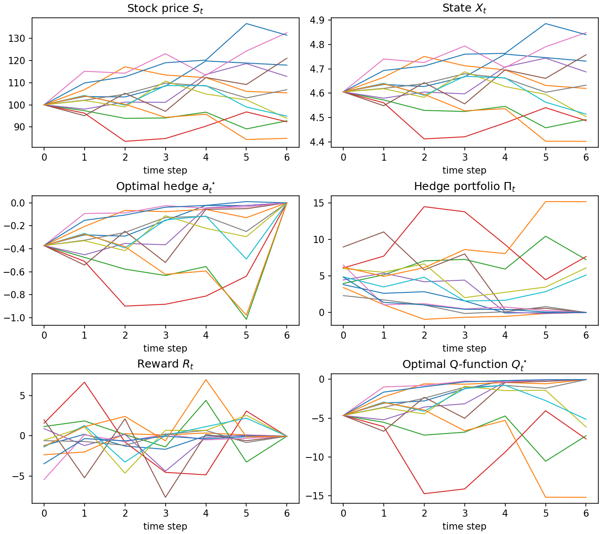
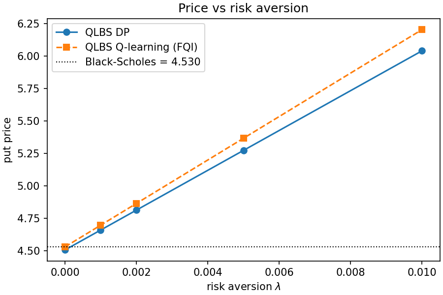
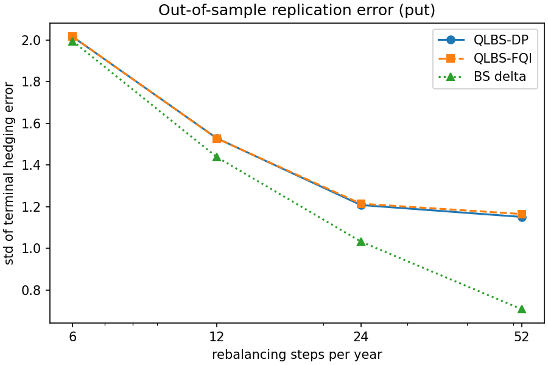
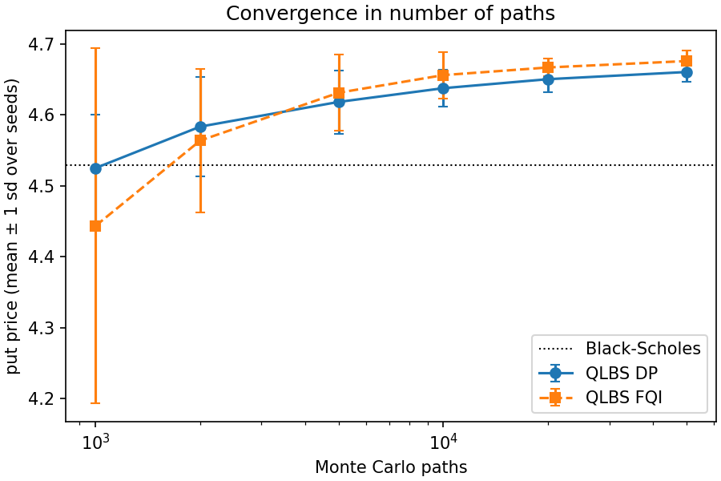

# QLBS: Option Pricing and Hedging with Reinforcement Learning

Pricing and hedging a European option as a **Markov decision process**, following Halperin's QLBS model ("Q-Learner in the Black-Scholes(-Merton) Worlds"). The hedger's problem is cast as stochastic optimal control with a quadratic (mean-variance) risk objective under discrete rebalancing, then solved two ways:

- **Dynamic programming:** model-based backward recursion, with the hedge and the Q-function expanded in B-spline features.
- **Q-learning (fitted Q iteration):** model-free and off-policy. The agent sees only trajectories of *noisy* hedges and the rewards they earned, and recovers the optimal hedge and the option price.

Both are benchmarked against **Black-Scholes** (closed-form price, delta hedging) and **risk-neutral Monte Carlo** across volatility regimes, rebalancing frequencies, risk aversion levels and sample sizes.



## Results

All numbers below are produced by `python scripts/run_experiments.py` (≈2 minutes on a laptop). Setup: $S_0=K=100$, $\mu=5\%$, $r=3\%$, $T=1$ year, ATM European put unless stated, risk aversion $\lambda=0.001$.

### Base case: 6 rebalancing dates, σ = 15%, 10,000 paths

| Option | Black-Scholes | Monte Carlo (risk-neutral) | QLBS DP | QLBS Q-learning |
|---|---|---|---|---|
| Put | 4.530 | 4.535 ± 0.016 | 4.660 | 4.697 |
| Call | 7.485 | 7.495 ± 0.024 | 7.884 | 7.961 |

QLBS prices sit above Black-Scholes by design. In a discretely rebalanced world the hedge is imperfect, and the price includes a premium for the residual risk the seller keeps. The Q-learner, trained only on off-policy data, recovers the DP price to within 1% for the put.

### Price vs risk aversion
With λ = 0 the QLBS price collapses to the Black-Scholes price (4.507 vs 4.530); the risk premium grows linearly in λ.



### Volatility regimes and rebalancing frequency
Learned hedges are evaluated **out of sample**: fitted on 50,000 training paths and applied to 20,000 fresh paths, against Black-Scholes delta hedging on the same paths. Averages over 5 seeds.

| σ (24 steps) | BS price | QLBS price (λ=0) | QLBS price (λ=0.001) | Hedge error std, QLBS | Hedge error std, BS delta |
|---|---|---|---|---|---|
| 10% | 2.626 | 2.608 | 2.796 | 0.796 | 0.668 |
| 15% | 4.530 | 4.505 | 5.011 | 1.208 | 1.032 |
| 25% | 8.393 | 8.360 | 9.862 | 1.981 | 1.742 |
| 40% | 14.183 | 14.144 | 17.740 | 3.101 | 2.786 |

| Rebalancing steps (σ=15%) | QLBS price (λ=0) | QLBS price (λ=0.001) | Hedge error std, QLBS | Hedge error std, BS delta |
|---|---|---|---|---|
| 6 | 4.503 | 4.657 | 2.015 | 1.994 |
| 12 | 4.508 | 4.778 | 1.528 | 1.438 |
| 24 | 4.505 | 5.011 | 1.208 | 1.032 |
| 52 | 4.481 | 5.525 | 1.151 | 0.707 |



What this shows:
- **Pricing.** Without risk aversion, QLBS matches Black-Scholes within 1.1% in every regime tested. It learns the right price from simulated data without being told the Black-Scholes formula.
- **Risk premium.** With λ > 0 the premium grows with volatility and with the number of rebalancing dates. The variance penalty is charged once per step and isn't scaled by Δt, which is how the model is specified.
- **Hedging.** At 6 rebalancing dates the learned hedge is as good as Black-Scholes delta (replication error 2.015 vs 1.994). With finer rebalancing it falls behind (1.6× delta's error at 52 steps). The 12-function spline basis and finite sample sizes can't resolve the sharp delta profile near expiry. The model-free hedge matches the DP hedge throughout.

### Convergence in the number of paths
Put price, mean ± 1 sd over 10 seeds. Seed-to-seed noise drops from 0.076 at 1,000 paths to 0.013 at 50,000.



Full tables: [`results/summary.md`](results/summary.md) and the CSVs in `results/`.

## Method

**State.** Stock paths follow GBM under the real-world measure. The state is the drift-adjusted log price $X_t = \log S_t - (\mu - \sigma^2/2)\,t\,\Delta t$, expanded in 12 degree-4 B-spline basis functions $\Phi_n(X_t)$.

**Hedge portfolio.** Rolled back from the payoff: $\Pi_T = H(S_T)$, $\Pi_t = \gamma(\Pi_{t+1} - a_t \Delta S_t)$, where $\Delta S_t = S_{t+1} - e^{r\Delta t}S_t$ and $\gamma = e^{-r\Delta t}$. The hedge $a_t^\star(X_t) = \sum_n \phi_{nt}\Phi_n(X_t)$ minimises $\mathrm{Var}[\Pi_t \mid \mathcal F_t]$ (ridge regression on the features).

**Reward and Bellman equation.** $R_t = \gamma a_t \Delta S_t - \lambda \mathrm{Var}[\Pi_t]$, and

$$Q_t^\star(x,a) = \mathbb E_t\left[R_t + \gamma \max_{a'} Q_{t+1}^\star(X_{t+1}, a')\right], \qquad Q_T^\star = -\Pi_T - \lambda\,\mathrm{Var}[\Pi_T].$$

The option price is $-Q_0^\star(X_0, a_0^\star)$.

**Fitted Q iteration.** Off-policy data come from a behaviour policy $a_t = a_t^\star \cdot U[1-\eta, 1+\eta]$ with $\eta = 0.5$. The Q-function is quadratic in the action, $Q_t(x,a) = \mathbf W_t \cdot \left[(1, a, a^2/2) \otimes \Phi(x)\right]$, fitted backward in time by least squares on Bellman targets.

**Implementation notes**
- Fully vectorised NumPy; the full experiment suite runs in about 100 seconds.
- Ridge penalties are scaled to the data. A fixed absolute penalty made fitted Q iteration diverge on horizons of 24+ steps.
- B-spline features come from SciPy. The `bspline` package used in earlier versions returns an all-zero row at the upper end of the range.
- The hedge is the pure variance-minimising one. Halperin's full mean-variance hedge adds a drift term proportional to $\Delta S_t / (2\gamma\lambda)$, which is not used here.
- Tests check put-call parity, that the basis is a partition of unity, that the pricing recursion with Black-Scholes deltas recovers the Black-Scholes price, and that Q-learning recovers the DP price.

## Run it

```bash
python -m venv .venv
.venv/Scripts/activate        # Windows; use `source .venv/bin/activate` on macOS/Linux
pip install -e ".[dev]"
python scripts/run_experiments.py           # all tables and figures -> results/
python scripts/run_experiments.py --quick   # fast smoke run
pytest
```

The notebook [`notebooks/qlbs_walkthrough.ipynb`](notebooks/qlbs_walkthrough.ipynb) walks through the model step by step.

```python
from qlbs import Market, Simulation, solve_dp, solve_fqi, off_policy_data

sim = Simulation(Market(sigma=0.15), steps=6, paths=10_000, seed=42)
dp = solve_dp(sim, "put", risk_lambda=0.001)
a, pi, R = off_policy_data(sim, dp.hedge, "put")
print(dp.price, solve_fqi(sim, a, pi, R).price)
```

## Project structure

```
src/qlbs/
  simulation.py      GBM paths, state variable, B-spline features
  qlbs.py            DP solver, off-policy data, fitted Q iteration, replication error
  black_scholes.py   closed-form prices and deltas, risk-neutral Monte Carlo
scripts/run_experiments.py   every table and figure in this README
notebooks/qlbs_walkthrough.ipynb
results/             generated tables (CSV, Markdown) and figures
tests/
```

## References
- I. Halperin, "QLBS: Q-Learner in the Black-Scholes(-Merton) Worlds", *Journal of Derivatives*, 2020 (arXiv:1712.04609).
- I. Halperin, "The QLBS Q-Learner Goes NuQLear: Fitted Q Iteration, Inverse RL, and Option Portfolios", *Quantitative Finance*, 2019 (arXiv:1801.06077).
- F. Black and M. Scholes, "The Pricing of Options and Corporate Liabilities", *Journal of Political Economy*, 1973.
